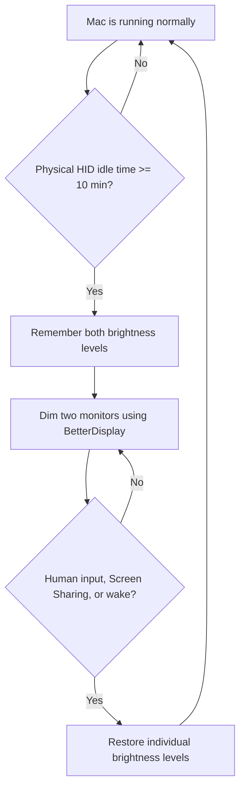

<div align="center">

# Mac Awake · Displays Dark
### BetterDisplay HID Idle Dimmer

**Dim two Mac displays without sleeping the desktop — and restore each display's original brightness when you return.**


[Русская версия](README.ru.md) · [Quick start](#quick-start) · [Disable / uninstall](#disable-pause-or-uninstall) · [Mac + Codex](#mac--codex-a-potential-workaround-not-a-lock-bypass)

</div>

---

When your Mac is doing autonomous work — running Codex, Roblox Studio, Blender, automation or long jobs — you may want **the graphical session to remain available** while the **physical monitors become dark after you walk away**.

This small open-source utility combines [BetterDisplay](https://github.com/waydabber/BetterDisplay) and [Hammerspoon](https://www.hammerspoon.org/) with a tiny native **CoreGraphics HID-idle helper**.

> [!IMPORTANT]
> **This is not a macOS security lock bypass.** It does not unlock a locked Mac, bypass passwords, suppress privacy/security overlays, or guarantee uninterrupted Codex Computer Use. It can *potentially* help with workflows disrupted by **display sleep or idle-triggered screen behavior**, because the Mac keeps a running graphical desktop while its monitors are dimmed. Actual session-locking rules are separate.

## What it does

- ⏱ **Idle timer:** after 10 minutes without detected hardware-oriented input, dim both displays (after initial setup and testing).
- 🌑 **Deep dimming:** BetterDisplay **Combined Brightness** blends hardware adjustment and software dimming to reach very dark levels without deliberately putting the monitors to sleep.
- 🔆 **Individual recovery:** saves the brightness of the main and non-main display separately, then restores both when you interact.
- 🖱 **HID-oriented detection:** often ignores events generated in a software session, such as automation by Codex. **Not guaranteed for all injected events or virtual HID drivers.**
- 🖥 **Screen Sharing:** best-effort detection of an established Apple Screen Sharing / VNC TCP/5900 connection.
- 🛠 **Safer long sessions:** persistent timer references, independent watchdog, wake/session restore handlers, a restore snapshot, and timestamped logs.
- 🔐 **Local-only:** no cloud service, account credentials, keystroke recording or cursor-position history.
- ⛑ **Emergency shortcut:** `Control + Option + Command + R` restores the original levels and pauses auto-dimming for 30 minutes.

### How it works



**Display dark ≠ display asleep ≠ macOS locked.** Depending on the monitor, a software-black screen may still have backlight glow and use power. Screenshot or remote-capture tools might also see the software dimming overlay.

## Requirements

- **macOS** with two connected displays (one main, one non-main).
- **BetterDisplay** installed at `/Applications/BetterDisplay.app`, with **CLI access enabled** and **Combined brightness** configured for each display; some features/licensing depend on the BetterDisplay version.
- **Hammerspoon**, running with Accessibility permission and preferably set to **Launch at login**.
- **Apple Command Line Tools**, for `clang` and the macOS SDK (`xcode-select --install`).
- The standard local, logged-in macOS graphical session. No `sudo` is required by the installer.

This release assumes exactly two active physical monitors. Do not use it as-is for a three-display configuration or a different display-selector layout.

## Quick start

1. Install and launch [BetterDisplay](https://github.com/waydabber/BetterDisplay) and [Hammerspoon](https://www.hammerspoon.org/). Grant Hammerspoon **Accessibility** access. In BetterDisplay, enable **Combined brightness** for *both* monitors and make sure the CLI commands work.
2. Install Apple's CLI tools if necessary:

   ```bash
   xcode-select --install
   ```

3. Clone this repository and run the **standalone** installer:

   ```bash
   git clone https://github.com/bighaired/betterdisplay-hid-idle-dimmer.git
   cd betterdisplay-hid-idle-dimmer
   bash install.sh
   ```

4. In the Hammerspoon menu choose **Reload Config**. The installer makes dated backups of the previous `init.lua`, module and HID helper, then installs the current files without replacing other `init.lua` configuration.
5. **First run is intentionally safe:** 15 seconds idle, **5%** combined brightness. Try it without touching mouse/keyboard, then move a **physical** mouse. Confirm **both** displays recover normally. Test with the actual Codex Computer Use events and your actual remote-access setup before changing the defaults.
6. After successful tests, edit the top of `~/.hammerspoon/betterdisplay_idle_dim.lua`:

   ```lua
   local IDLE_SECONDS = 600  -- 10 minutes
   local DIM_LEVEL = 0.0     -- 0% combined brightness
   ```

   Then **Reload Config** again.

### Verify BetterDisplay CLI

```bash
BD=/Applications/BetterDisplay.app/Contents/MacOS/BetterDisplay
"$BD" get -displayWithMainStatus -combinedBrightness
"$BD" get -displayWithNonMainStatus -combinedBrightness
~/.hammerspoon/physical_idle_query --both
```

The BetterDisplay commands return decimal brightness levels (typically between `0` and `1`). The helper prints `HID_SECONDS` and `SESSION_SECONDS`. Verify the HID number resets when **you** move the mouse; also compare it when Codex moves the cursor.

### Diagnostics

In **Hammerspoon Console**:

```lua
print(BDIdleDimStatus())
```

In Terminal:

```bash
tail -n 60 ~/.hammerspoon/betterdisplay_idle_dim.log
```

No raw keystrokes, captured screenshots, or cursor coordinates are stored in the diagnostic log.

## Disable, pause or uninstall

> [!CAUTION]
> If your display becomes too dark, first press **Control + Option + Command + R**. It restores saved brightness and pauses auto-dimming for **30 minutes**.

### Temporarily pause (30 minutes)

Press `Ctrl + Option + Cmd + R`. No file changes; automatic dimming resumes after the hold period.

### Permanently disable (keep the files)

From the cloned project directory:

```bash
bash disable.sh
```

Then select **Hammerspoon → Reload Config**. The module restores its saved brightness and does not start the dimmer while the disabled marker exists.

To enable again:

```bash
bash enable.sh
```

Then **Reload Config**.

### Fully uninstall

Prefer pressing the emergency shortcut first if the monitors are currently black. Then:

```bash
bash uninstall.sh
```

**Crucially, finish with Hammerspoon → Reload Config** (or quit and relaunch Hammerspoon), otherwise previously loaded timers remain in memory until the configuration is reloaded.

Uninstall removes the utility's loader line(s) from `~/.hammerspoon/init.lua`, its Lua module, native helper and enable/disable marker. It **does not uninstall BetterDisplay or Hammerspoon**, change your login permissions, or delete other Hammerspoon configuration. Existing backups and the log remain to aid troubleshooting and can be manually deleted afterward.

If using a customized `init.lua`, inspect the dated `init.lua.backup-uninstall-*` file after uninstall. If you previously disabled macOS sleep or lock behavior in **System Settings**, restore those preferences manually; this utility does not change them.

### Emergency manual restoration without Hammerspoon

```bash
bash restore-brightness.sh
```

If a brightness snapshot exists, the script attempts to restore both saved values. Otherwise it uses a **60% fallback on both displays**; only use it when recovery is necessary. If the regular dimmer is still active, disable it and **Reload Config** afterward.

## Mac + Codex: a potential workaround, not a lock bypass

Some Mac automation workflows encounter problems when the display sleeps or the screen transitions to a lock state while Codex operates Roblox Studio, Blender, or other GUI apps. This project explores a **different approach**:

- keep the current graphical session active, using Hammerspoon's display-idle sleep prevention;
- turn **only the visible brightness** down rather than intentionally turning off the displays;
- restore brightness for a person without necessarily waking the monitors for every synthetic cursor movement.

**In theory, this may avoid some *idle display* transitions associated with interrupted GUI automation.** However, macOS security lock, account authentication, enterprise policy, and Codex/Computer Use security overlays are separate systems. This project **cannot prevent or remove genuine security locking** and does not circumvent those controls. If a GUI automation system stops on a true lock or privacy prompt, troubleshoot that system directly.

## Limitations and safety

- **HID filtering is best-effort.** Virtual drivers, remote-control tools or programmatic input may register as HID events. Physical vs. synthetic input is not a hard security boundary.
- **VNC detection is best-effort.** Only established TCP/5900 connections are checked. Other remote tools, including different Screen Sharing transports, might not be detected.
- **Not a power-saving sleep mode.** Dimming is not necessarily power-off; OLED/LCD backlight behavior varies.
- **Remote capture may see a dark image.** Test with your own Screen Sharing and Computer Use setup.
- **Accessibility and BetterDisplay privileges** are required; review third-party app permissions yourself.
- **Only two displays** are supported by the current main/non-main selectors.
- **No universal hardware validation.** The underlying v2.2 workflow was exercised on one dual-monitor setup; this standalone public packaging has not been tested across different macOS releases and monitors.

## Files

| File | Purpose |
|---|---|
| `physical_idle_query.c` | Tiny CoreGraphics HID-idle probe (compiled locally; no prebuilt binary) |
| `betterdisplay_idle_dim.lua` | Main Hammerspoon logic: dim, restore, watchdog, wake hooks, logs |
| `install.sh` | Standalone installer; compiles the helper and backs up Hammerspoon config |
| `disable.sh`, `enable.sh` | Persistent opt-out / opt-in |
| `restore-brightness.sh` | Emergency restoration without Hammerspoon |
| `uninstall.sh` | Remove this utility's files and `init.lua` import |
| `README.ru.md` | Russian documentation |

## References

- [BetterDisplay – Integration features and CLI](https://github.com/waydabber/BetterDisplay/wiki/Integration-features%2C-CLI)
- [Hammerspoon – hs.timer](https://www.hammerspoon.org/docs/hs.timer.html)
- [Hammerspoon – hs.caffeinate](https://www.hammerspoon.org/docs/hs.caffeinate.html)
- [Hammerspoon – hs.caffeinate.watcher](https://www.hammerspoon.org/docs/hs.caffeinate.watcher.html)

## License

MIT © 2026 [bighaired](https://github.com/bighaired). This is an independent community utility, not affiliated with or endorsed by BetterDisplay, Hammerspoon, OpenAI, Codex, Apple or Roblox.